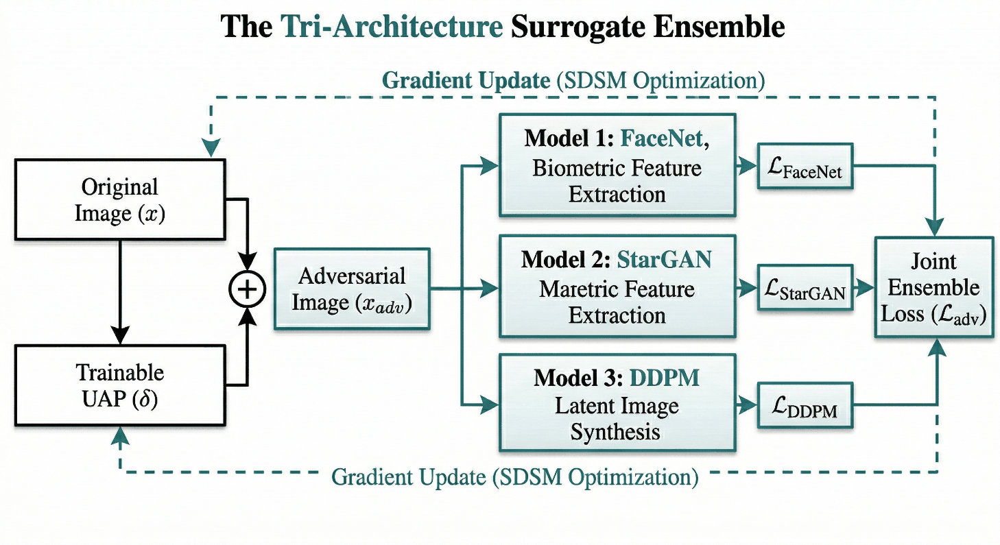
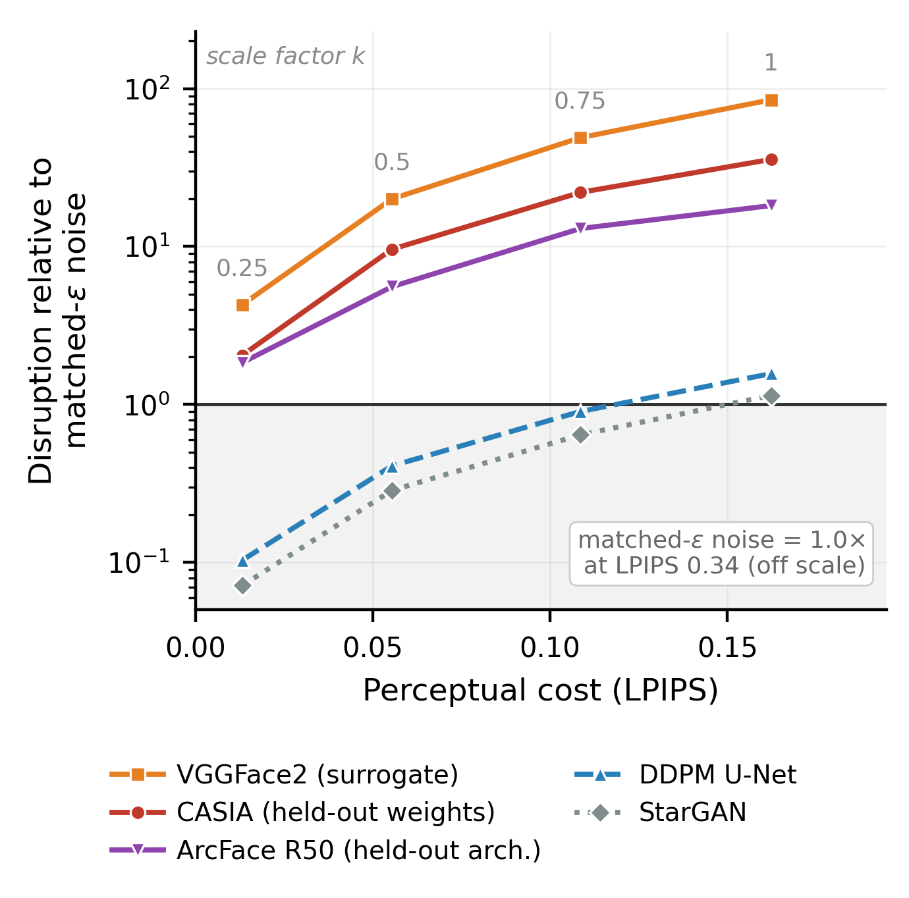

<div align="center">

# Geometrically-aware Universal Adversarial Perturbations

### for Cross-Architecture Facial Privacy Protection

[](https://www.python.org/)
[](https://pytorch.org/)
[](https://developer.nvidia.com/cuda-toolkit)
[](#-installation)
[](https://opensource.org/licenses/MIT)

**Nethum Dinusara Perera**

Informatics Institute of Technology (IIT), affiliated with Robert Gordon University, Aberdeen, UK<br>
BSc. (Hons) Artificial Intelligence and Data Science, 2025/2026<br>
Supervised by **Akarshani Amarasinghe**

<br>



<sub>One trainable perturbation δ, bounded by L<sub>∞</sub> ≤ 0.04 (10.2/255), optimised jointly against three frozen surrogates.<br>
Each contributes a directional feature-space loss; gradients accumulate sequentially so peak memory stays under 4 GB.</sub>

</div>

---

> [!NOTE]
> Submitted for the BSc thesis as *A Proactive Tri-Architecture Black-Box Defense
> Against Deepfakes Using Geometrically-Aware Universal Perturbations*. The paper
> was retitled when the evaluation was rebuilt: the biometric results held up,
> the generative ones did not. See [Results](#-results).

## Contents

- [Overview](#-overview)
- [Results](#-results)
- [Stealth/robustness operating curve](#-stealthrobustness-operating-curve)
- [Comparison with Fawkes](#-comparison-with-fawkes)
- [Limitations](#-limitations)
- [Repository structure](#-repository-structure)
- [Installation](#-installation)
- [Usage](#-usage)
- [Models and datasets](#-models-and-datasets)
- [Citation](#-citation)

---

## 📖 Overview

Facial images posted publicly can be scraped to enrol identities in
face-recognition systems without consent, or used as source material for
generative manipulation. Reactive detection of manipulated media generalises
poorly to generators unseen during training, which motivates **proactive**
defences: perturbing an image *before* it is shared so that downstream models
fail on it.

This repository implements a **Universal Adversarial Perturbation (UAP)** — one
fixed tensor, computed once offline and added to any image thereafter.

| | |
|---|---|
| **Optimised in** | feature space, not pixel space |
| **Against** | a heterogeneous ensemble of three frozen networks: a FaceNet identity encoder, a StarGAN generator, and a DDPM U-Net |
| **Objective** | a directional loss that minimises cosine similarity while maximising mean-squared error between clean and perturbed features |
| **Budget** | peak memory below **4 GB**, via sequential gradient accumulation |
| **Cost at protection time** | **O(1)** — a tensor addition. No optimiser, gradients or model at the point of use |

---

## 📊 Results

Measured on **13,232 held-out LFW images**, sharing no identities with the
5,000-image CelebA-HQ + FFHQ optimisation set. The control is uniform random
noise at the **same L<sub>∞</sub> bound**, drawn per image with a fixed seed.

**ASR** is the fraction of images exceeding τ<sub>99</sub>, the 99th percentile
of that model's noise baseline — a bar the baseline clears for 1.0% of images by
construction, rather than a threshold chosen after the fact.

<table>
<thead>
<tr><th align="left">Metric</th><th align="right">Noise</th><th align="right">Ours</th><th align="right">Ratio</th></tr>
</thead>
<tbody>
<tr><td colspan="4"><i>Perceptual cost</i></td></tr>
<tr><td>LPIPS ↓</td><td align="right">0.3617</td><td align="right"><b>0.1723</b></td><td align="right">0.48×</td></tr>
<tr><td>SSIM ↑</td><td align="right">0.7566</td><td align="right"><b>0.7839</b></td><td align="right">1.04×</td></tr>
<tr><td>PSNR dB ↑</td><td align="right"><b>32.76</b></td><td align="right">29.27</td><td align="right">0.89×</td></tr>
<tr><td colspan="4"><i>Biometric disruption — cosine distance ↑ (ASR at τ<sub>99</sub>)</i></td></tr>
<tr><td>FaceNet&nbsp;VGGFace2 &nbsp;<sub>surrogate</sub></td><td align="right">0.0028</td><td align="right"><b>0.2125</b> <sub>(100%)</sub></td><td align="right"><b>77.2×</b></td></tr>
<tr><td>FaceNet&nbsp;CASIA &nbsp;<sub>held-out weights</sub></td><td align="right">0.0081</td><td align="right"><b>0.2738</b> <sub>(100%)</sub></td><td align="right"><b>33.6×</b></td></tr>
<tr><td>ArcFace&nbsp;R50 &nbsp;<sub>held-out architecture</sub></td><td align="right">0.0143</td><td align="right"><b>0.2662</b> <sub>(100%)</sub></td><td align="right"><b>18.6×</b></td></tr>
<tr><td colspan="4"><i>Generative disruption — MSE ↑</i></td></tr>
<tr><td>DDPM U-Net &nbsp;<sub>surrogate</sub></td><td align="right">0.0072</td><td align="right">0.0114 <sub>(100%)</sub></td><td align="right">1.57×</td></tr>
<tr><td>StarGAN &nbsp;<sub>surrogate</sub></td><td align="right">0.0015</td><td align="right">0.0017 <sub>(0.6%)</sub></td><td align="right">1.16×</td></tr>
</tbody>
</table>

<sub>ArcFace is measured on a 1,000-image subset. All rows p &lt; 10<sup>-100</sup>, paired Wilcoxon signed-rank.</sub>

**Three things are worth reading off this table.**

**It transfers across architectures, not just checkpoints.** ArcFace R50 is a
different backbone, loss family and training corpus, none of it seen during
optimisation, and absolute displacement there (0.2662) is as large as on the
encoder the perturbation was built against (0.2125). The *multiplier* falls
monotonically — 77.2 → 33.6 → 18.6 — but that is driven entirely by the
baseline's noise floor rising as the recogniser becomes more sensitive to
unstructured perturbation. A method transferring by coincidence would not
produce an ordering this regular.

**It is cheaper than the noise it beats.** LPIPS 0.1723 against 0.3617, on every
one of the 13,232 images. The perturbation is not *smaller* than noise — it
carries 1.64× the energy — it is shaped so the same magnitude falls in
directions a perceptual metric discounts. PSNR runs the other way precisely
because PSNR measures energy.

**It survives ordinary image handling.** Displacement retained after each
transform, applied identically to reference and perturbed image so the
transform's own effect cancels:

| Transform | Retained | vs noise |
|---|---:|---:|
| None | 100.0% | 85.0× |
| JPEG q=50 | 103.7% | 45.0× |
| Blur σ=1.0 | 93.1% | 152.0× |
| Downsample 4× | 77.7% | 39.1× |

Low-pass operations attenuate unstructured noise far more than they attenuate
this perturbation, so blur *widens* the gap from 85× to 152×.

### Generative disruption is narrow — reported as a negative result

**StarGAN disruption is not established.** At τ<sub>99</sub> the perturbation
succeeds on 0.6% of images, *below* the baseline's own 1%. The paired test is
significant (p ≈ 5×10<sup>-139</sup>) but the shift is small relative to the
baseline's spread. Statistical reliability and practical relevance are not the
same thing.

**The diffusion effect is real but bounded to low denoising strength.** Sampling
from the model directly, rather than reading its noise-prediction error:

| t<sub>start</sub> | 50 | 100 | 200 | 400 |
|---|---:|---:|---:|---:|
| Ours vs matched noise | **1.78×** | 1.37× | 1.08× | 1.02× |
| p | 2×10<sup>-6</sup> | 2×10<sup>-6</sup> | 4×10<sup>-4</sup> | 0.083 |

At high denoising strength the output departs from the input whatever is added
to it, leaving nothing for a perturbation to contribute. The protection applies
to image-to-image editing at low strength, and not to generation from heavy
noise.

---

## 📈 Stealth/robustness operating curve

Because the perturbation is a fixed tensor, scaling it by *k* traces an
operating curve at no additional training cost — and lets the method be compared
against others at **matched perceptual cost** rather than at a single point.

<div align="center">

</div>

Biometric disruption stays above the noise baseline at **every** scale tested,
including *k* = 0.25 where perceptual cost is an order of magnitude lower.
Generative disruption crosses parity only near full strength, and StarGAN never
meaningfully does — the shaded region is where the perturbation buys nothing.

> The curve is **not** an efficient frontier. Retraining with a stronger
> perceptual penalty beats attenuating a perturbation trained with a weaker one:
> Run E reaches CASIA displacement 0.1664 at LPIPS 0.0785, where scaling the
> selected configuration to the same cost yields ≈0.11. The curve describes what
> a deployed system can do by dialling one distributed tensor.

---

## ⚖️ Comparison with Fawkes

Run through the authors' released application and evaluated on the same
pipeline, unmodified (99 held-out images; one was emitted identical to its input
by a failed detection and excluded).

| | Noise | Fawkes | Ours |
|---|---:|---:|---:|
| LPIPS ↓ | 0.3550 | **0.0283** | 0.1656 |
| SSIM ↑ | 0.7624 | **0.9897** | 0.7877 |
| FaceNet-VGGFace2 ↑ | 0.0026 | 0.0874 | **0.1928** |
| FaceNet-CASIA ↑ | 0.0077 | 0.1050 | **0.2500** |
| ArcFace R50 ↑ | 0.0141 | 0.0640 | **0.2467** |

**At matched perceptual cost, Fawkes is the stronger method for biometric
evasion, by roughly threefold.** It attains CASIA displacement 0.1050 at LPIPS
0.0283, where scaling ours to the same cost yields ≈0.035. This is expected:
Fawkes solves a separate optimisation for every image, against face recognition
alone, at roughly twenty seconds each.

Neither method dominates. The gap narrows to 1.4× on the held-out architecture —
normalising each method by its own VGGFace2 displacement, Fawkes retains 1.20 on
held-out weights but falls to 0.73 on the held-out architecture, where ours
retains 1.30 and 1.28. Protection here is a single tensor addition requiring no
optimisation at deployment, and carries a measured effect on a diffusion model,
which Fawkes does not target.

**Where minimal visible change is the priority and only face recognition is in
scope, Fawkes is the better choice on this evidence.**

---

## ⚠️ Limitations

- **One published baseline.** Fawkes, low mode, 99 images. CMUA-Watermark is
  distributed through a host that could not be reached; LowKey was not evaluated.
- **A published perturbation is a known perturbation.** An adversary who obtains
  the tensor can subtract it, train a detector for it, or fine-tune a recogniser
  on perturbed images. Per-image methods do not share this exposure. **No claim
  is made against an adaptive adversary.**
- **Dual use.** The method degrades face recognition without distinguishing
  between uses, and would equally degrade recognition where it is authorised.
- **Generative disruption is narrow.** StarGAN is not established; the diffusion
  effect is measured on one architecture across two checkpoints, so there is no
  evidence of transfer to a *different* diffusion architecture. End-to-end
  pipelines such as a face-swap tool or text-conditioned editor were not
  evaluated.
- **Single run, metric-only perceptual assessment.** Optimised once (seed 42) at
  ~60 h per run; reported variability is across evaluation images, not seeds.
  LPIPS, SSIM and PSNR stand in for visibility, with no human study.
- **Scope.** Still images at 256×256. Video is out of scope. ArcFace is evaluated
  on resized MTCNN crops rather than its own alignment template, applied
  identically to both conditions. Robustness covers nine single transforms, not
  composed pipelines or adversarial purification.

---

## 🏗️ Repository structure

```text
defense_model/
├── config.yaml                 # Paths and hyperparameters, read by every script
├── requirements.txt            # Pinned direct dependencies
├── requirements-lock.txt       # Full environment freeze
│
├── src/uap/                    # Shared library. No entry points.
│   ├── config.py               #   load_config / seeding / device / PROJECT_ROOT
│   ├── compat.py               #   `aim` stub, imported before torch
│   ├── data.py                 #   image listing and loading, FlatFolderDataset
│   ├── perturbation.py         #   UAP loading, matched-ε noise control
│   ├── augment.py              #   Expectation-over-Transformation augmentations
│   └── ensemble.py             #   Tri-architecture surrogate ensemble
│
├── scripts/                    # Entry points. Run from anywhere.
│   ├── preprocess.py           #   Build the train and evaluation sets
│   ├── train.py                #   Optimise the UAP
│   ├── evaluate.py             #   Stealth + per-model disruption
│   ├── eval_arcface.py         #   Held-out architecture
│   ├── eval_heldout_ddpm.py    #   Held-out diffusion checkpoint
│   ├── eval_ddpm_sampling.py   #   Does the generated image change?
│   ├── eval_robustness.py      #   JPEG / resize / blur / bit-depth
│   ├── eval_ablation.py        #   Hyperparameter runs A–E
│   ├── baseline_folder.py      #   Any published defence, from a folder
│   ├── baseline_cmua.py        #   CMUA-Watermark from its released tensor
│   ├── verify_onnx_batching.py #   Confirms batched ONNX == single-image
│   ├── stats.py                #   Bootstrap CIs, paired Wilcoxon, effect sizes
│   └── plot_operating_curve.py #   The operating-curve figure
│
├── app/app.py                  # Streamlit demonstration interface
│
├── data/                       # processed/ (evaluation set), Demo/
├── models/                     # ArcFace ONNX weights
├── stargan_celeba_256/         # StarGAN generator checkpoint
├── third_party/stargan/        # Vendored StarGAN source
├── results/                    # Runs and per-image CSVs → results/README.md
├── figures/                    # Paper figures and operating-curve data
├── notebooks/                  # Exploratory work
└── archive/                    # Superseded code and runs → archive/README.md
```

Scripts put `src/` and `third_party/` on `sys.path` via `scripts/_path.py`, and
`config.yaml` paths resolve against the project root, so **any script runs from
any working directory**.

> [!TIP]
> Start with **[`results/README.md`](results/README.md)** — it maps every table
> and figure in the paper to the exact CSV it was computed from.

---

## 🛠️ Installation

**Prerequisites**

- Windows 11 or Linux (developed and verified on Windows 11)
- NVIDIA GPU with CUDA 12.1. **4 GB VRAM is sufficient** for the full
  tri-surrogate optimisation — sequential gradient accumulation exists precisely
  so a larger card is not required. Verified on an RTX 3050 (4 GB). Evaluation
  runs on CPU, more slowly.
- Python 3.10 (verified on 3.10.11)

```bash
git clone https://github.com/NethumDinusara/proactive-deepfake-defense.git
cd proactive-deepfake-defense

python -m venv venv
venv\Scripts\activate          # Windows
# source venv/bin/activate     # Linux

pip install -r requirements.txt

# CUDA builds need PyTorch's own index:
pip install torch==2.5.1+cu121 torchvision==0.20.1+cu121 \
    --extra-index-url https://download.pytorch.org/whl/cu121
```

> [!WARNING]
> **Do not upgrade numpy past 1.26.4.** numpy 2.x breaks `facenet-pytorch`,
> `lpips` and `scikit-image` in this stack, and it does so *silently* — results
> change rather than an error being raised. This is also why ArcFace is called
> through `onnxruntime` directly rather than through `insightface`, which pins
> `numpy>=2`. `requirements-lock.txt` holds the full freeze for a byte-exact
> reproduction.

---

## 🚀 Usage

**Generate the perturbation** (~60 h on a 4 GB card):

```bash
python scripts/preprocess.py     # build train/test sets first
python scripts/train.py
```

**Reproduce the evaluation** against an existing run:

```bash
RUN=run_ep30_eps0.04_geom1.2_lpips1.8_20260309_233825

python scripts/evaluate.py           --run_folder $RUN            # headline table
python scripts/eval_arcface.py       --run_folder $RUN --n 1000   # held-out architecture
python scripts/eval_robustness.py    --run_folder $RUN --n 250    # transform robustness
python scripts/eval_ddpm_sampling.py --run_folder $RUN --n 20     # sampling sweep

python scripts/stats.py --csv results/$RUN/results_v2_FINAL.csv   # CIs + paired tests
python scripts/plot_operating_curve.py \
    --csv results/$RUN/results_v2_curve_FINAL.csv \
          results/$RUN/results_arcface_curve.csv                  # operating curve
```

**Launch the demonstration interface:**

```bash
streamlit run app/app.py
```

Every per-image value is written in long format (`image, variant, metric,
value`), so any statistic can be recomputed offline without re-running a model.

---

## 🧠 Models and datasets

**Model weights**

| Model | Role | Source |
|---|---|---|
| FaceNet (InceptionResnetV1) | Identity encoder; VGGFace2 is the surrogate, CASIA-Webface the held-out weights | Auto-downloaded by `facenet-pytorch` |
| StarGAN generator | GAN manipulation surrogate | `200000-G.ckpt` (CelebA 256×256) → `stargan_celeba_256/` |
| DDPM U-Net | Diffusion surrogate | `google/ddpm-celebahq-256` via `diffusers` |
| ArcFace R50 | Held-out architecture | `w600k_r50.onnx` from the [insightface releases](https://github.com/deepinsight/insightface/releases) → `models/buffalo_l/` |

Stable Diffusion v1.5 is used **only** by the demo in `app/app.py`; no reported
result depends on it.

**Datasets**

| Dataset | Use |
|---|---|
| CelebA-HQ + FFHQ | 5,000 images (2,500 each) for optimising the perturbation |
| Labeled Faces in the Wild | 13,232 MTCNN-aligned images for evaluation, sharing no identities with the optimisation set |

---

## 📄 Citation

```bibtex
@misc{perera2026uap,
  title  = {Geometrically-aware Universal Adversarial Perturbations
            for Cross-Architecture Facial Privacy Protection},
  author = {Perera, Nethum Dinusara and Amarasinghe, Akarshani},
  year   = {2026},
  note   = {BSc (Hons) Artificial Intelligence and Data Science,
            Informatics Institute of Technology / Robert Gordon University}
}
```

## 📜 License

Released under the [MIT License](https://opensource.org/licenses/MIT).
